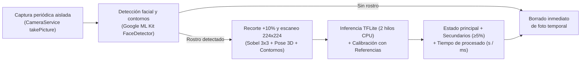

# Mencia — Detector de Estado de Ánimo Facial (100 % Offline)

Aplicación móvil desarrollada en **Flutter** para el reconocimiento periódico de expresiones y estados de ánimo faciales ejecutada íntegramente en el dispositivo (**100 % sin conexión a internet**), utilizando **Google ML Kit Face Detection** y **TensorFlow Lite (TFLite)**.

Diseñada y optimizada específicamente para las restricciones térmicas y de hardware del **Xiaomi Mi A2** (*Qualcomm Snapdragon 660, GPU Adreno 512, 4 GB RAM, Android One 9/10*).

---

## Características principales

- **Privacidad estricta y ejecución 100 % local**:
  - La aplicación **no solicita el permiso `android.permission.INTERNET`** en [`AndroidManifest.xml`](android/app/src/main/AndroidManifest.xml). Ninguna imagen, recorte facial ni vector de características abandona jamás el dispositivo.
  - Limpieza inmediata en almacenamiento: cada captura temporal tomada por la cámara se elimina automáticamente del disco (`finally`) en cuanto finaliza la inferencia para no ocupar los 64 GB del dispositivo.
- **Escaneo de posición facial en alta resolución (`224x224`)**:
  - Captura fotográfica en alta definición (`ResolutionPreset.veryHigh` con *fallback* automático a `high`).
  - Extracción de ángulos 3D de pose de cabeza (*pitch*, *yaw*, *roll*), puntos clave (*landmarks*) y **malla densa de contornos faciales** (arco de cejas, apertura ocular y curvatura/apertura labial).
  - Escaneo espacial sobre rejilla de `224x224` píxeles con interpolación cúbica y operadores direccionales **Sobel 3x3** para extraer un vector de 14 características geométricas y de apariencia.
- **Inferencia híbrida de 7 estados de ánimo y estados secundarios (`≥ 5 %`)**:
  - Clasificación en las 7 emociones estándar: **Enfado** (`Angry`), **Asco** (`Disgust`), **Miedo** (`Fear`), **Alegría** (`Happy`), **Tristeza** (`Sad`), **Sorpresa** (`Surprise`) y **Neutral** (`Neutral`).
  - Además del estado de ánimo principal, muestra todos los **estados de ánimo secundarios con al menos un 5 % de probabilidad**, permitiendo identificar expresiones intermedias o mixtas, junto con el **tiempo exacto de procesado** en segundos y milisegundos.
- **Modo Entrenamiento interactivo**:
  - Permite visualizar en pantalla las **imágenes faciales tratadas** (recorte facial con +10 % de margen en 5 resoluciones configurables: `48x48`, `64x64`, `96x96`, `128x128` y `224x224`), revisar el estado de ánimo decidido y **Confirmar** o **Rechazar** indicando el estado correcto mediante un desplegable.
  - Los estados validados se incorporan automáticamente como prototipos de referencia para afinar los siguientes cálculos.
- **Definición de Estados de Ánimo de Referencia en Configuración**:
  - Espacio dedicado en **Configuración** donde se puede asignar a cada uno de los 7 estados de ánimo una **foto existente** (desde la galería/almacenamiento del dispositivo o de la sesión actual) o **capturarla en directo con la cámara activa**.
  - Estas imágenes actúan como patrón de referencia prioritario (`weight: 2.5`) para decidir el estado de ánimo resultante.
- **Protección térmica para Snapdragon 660 y Wakelock de bajo consumo**:
  - Nunca utiliza `startImageStream` en bucle continuo; realiza capturas periódicas aisladas (`takePicture`) configurables en segundos o minutos.
  - Intérprete TFLite restringido a **2 hilos de CPU** (`InterpreterOptions()..threads = 2`) sin delegados GPU inestables en Android 9/10.
  - Mantiene la actividad mediante `wakelock_plus` e incluye un modo de superposición de **bajo brillo** para evitar que el modo *Doze* de Android congele los temporizadores sin agotar la batería.

---

## Flujo de procesamiento



---

## Estructura del proyecto

```text
lib/
├── main.dart                                  # Punto de entrada y configuración de tema Material 3
├── core/
│   ├── constants/
│   │   └── app_constants.dart                 # Etiquetas (ES/EN), resoluciones, claves e invariantes de hardware
│   └── utils/
│       └── image_utils.dart                   # Recorte +10%, escaneo 224x224 Sobel 3x3, tensores y cálculo por referencias
├── services/
│   ├── camera_service.dart                    # Inicialización de cámara frontal y capturas aisladas (sin streams)
│   ├── ml_service.dart                        # Pipeline Google ML Kit (contornos/pose) + TFLite (2 hilos CPU)
│   └── storage_service.dart                   # Persistencia local (SharedPreferences) de historial, ajustes y referencias
└── presentation/
    ├── screens/
    │   ├── home_screen.dart                   # Panel principal, Modo Entrenamiento, estado en vivo y modo bajo brillo
    │   ├── settings_screen.dart               # Definición de los 7 estados de referencia, resolución, intervalo y cámara
    │   └── history_screen.dart                # Historial cronológico y gráfica de distribución de estados de ánimo
    └── widgets/
        ├── mood_status_card.dart              # Tarjeta de estado actual, secundarios ≥5% y tiempo de procesado
        ├── training_review_card.dart          # Carrusel de imágenes tratadas para confirmar o corregir expresiones
        └── mood_chart_widget.dart             # Gráfico horizontal de frecuencias por estado de ánimo
```

---

## Stack tecnológico y dependencias

| Paquete | Versión | Propósito |
| :--- | :--- | :--- |
| `camera` | `^0.11.0+2` | Captura fotográfica periódica con cámara frontal/trasera |
| `google_mlkit_face_detection` | `^0.12.0` | Detección de rostro, ángulos Euler 3D, *landmarks* y contornos offline |
| `tflite_flutter` | `^0.11.0` | Ejecución local del modelo `assets/models/emotion_model.tflite` en CPU |
| `image` | `^4.2.0` | Decodificación EXIF, recorte facial, interpolación cúbica y vista previa PNG |
| `shared_preferences` | `^2.2.3` | Almacenamiento local de historial, configuración y perfiles de referencia |
| `path_provider` | `^2.1.2` | Gestión de rutas temporales locales en el dispositivo |
| `wakelock_plus` | `^1.2.0` | Prevención de suspensión en segundo plano durante el seguimiento |
| `intl` | `^0.19.0` | Formateo de marcas de tiempo en el historial y Modo Entrenamiento |

---

## Requisitos de compilación Android

- **SDK mínimo (`minSdk`)**: `24` (óptimo para enlaces FFI de TensorFlow Lite y Google ML Kit).
- **SDK objetivo (`targetSdk`)**: `34`.
- **Compresión de modelo deshabilitada**: configurado `aaptOptions { noCompress 'tflite' }` en [`android/app/build.gradle`](android/app/build.gradle).
- **Reglas R8 / ProGuard**: incluidas en [`android/app/proguard-rules.pro`](android/app/proguard-rules.pro) para preservar los símbolos JNI de TensorFlow Lite y ML Kit en compilaciones `--release`.

---

## Instalación y puesta en marcha

1. **Instalar dependencias de Flutter**:
   ```bash
   flutter pub get
   ```

2. **Ejecutar en modo desarrollo (con un Xiaomi Mi A2 o dispositivo Android conectado por USB)**:
   ```bash
   flutter run
   ```

3. **Compilar y desplegar en modo Release (optimizado con R8)**:
   ```bash
   flutter run --release
   ```

4. **Generar el archivo APK de distribución (`app-release.apk`)**:
   ```bash
   flutter build apk --release
   ```

---

## Verificación y pruebas

El repositorio incluye pruebas unitarias y de *widgets* en [`test/widget_test.dart`](test/widget_test.dart) que validan el recorte facial con 10 % de margen, las 5 resoluciones de imagen tratada, el filtrado de estados secundarios (`≥ 5 %`), el cálculo geométrico con referencias validadas, la definición de estados de ánimo en Configuración y el formateo de tiempos de procesado.

```bash
# Comprobar formato del código
dart format --output=none --set-exit-if-changed .

# Ejecutar análisis estático
flutter analyze

# Ejecutar suite de tests
flutter test
```

